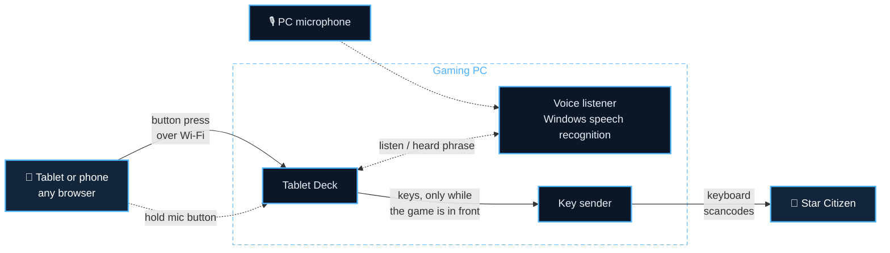

  

  
  
  
  

<h3 align="center">Turn any tablet or phone into a touch control panel for Star Citizen.</h3>

  A HUD-style button deck in your tablet's browser, where every button presses real keys on your gaming PC. 
  Free and open source. No app on the tablet, no account.

  <a href="https://github.com/nodieCode/tablet-deck/releases/latest"><b>⬇&nbsp;Download for Windows</b></a>
  &nbsp;&nbsp;·&nbsp;&nbsp;
  <a href="https://nodiecode.github.io/tablet-deck/try/"><b>▶&nbsp;Try it in your browser</b></a>
  &nbsp;&nbsp;·&nbsp;&nbsp;
  <a href="https://nodiecode.github.io/tablet-deck/"><b>Website</b></a>
  &nbsp;&nbsp;·&nbsp;&nbsp;
  <a href="https://buymeacoffee.com/nodiecode"><b>☕&nbsp;Buy me a coffee</b></a>

  

> [!NOTE]
> Fan project. Not affiliated with or endorsed by Cloud Imperium Games. Star
> Citizen and the manufacturer names belong to their owners; the emblems here
> are original designs, not the companies' logos.

**Contents:** [Features](#features) · [Get started](#get-started) ·
[Troubleshooting](#troubleshooting) · [Using Tablet Deck](#using-tablet-deck) ·
[Settings](#settings) · [How it works](#how-it-works) ·
[Safety and privacy](#safety-and-privacy) · [Developers](#developers)

## Features

<table>
<tr>
<td width="50%" valign="top">

### 🛸 A HUD for your tablet
Landing, power management, quantum, operator modes, shields, targeting,
salvage, mining, doors, emotes and more, on a two-half HUD that pages through
panels. Phones get their own layout. In English, Español, Français, Deutsch or Català.

</td>
<td width="50%" valign="top">

### 🎨 12 manufacturer themes
RSI, Drake, Aegis, Anvil, Origin, MISC, Crusader, Banu, Aopoa, Argo,
Consolidated Outland and Esperia, plus night mode. Press animations for
landing-gear struts, the quantum charge ring, decoy sparks, sliding doors and
more.

</td>
</tr>
<tr>
<td valign="top">

### 🎙️ Hold-to-talk voice commands
"Landing gear", "engage quantum", "shields up": hold the mic button and speak.
Windows' built-in speech recognition, offline. The **?** next to the mic lists
everything you can say.

</td>
<td valign="top">

### ⌨️ Follows your keybinds
Reads your Star Citizen keybinds, so if you rebind something in-game, the
button follows. An optional keybind profile covers actions that have no default
key.

</td>
</tr>
<tr>
<td valign="top">

### ✏️ Layout editor and starter layouts
Drag buttons around and change their keys, labels, icons and animations, and
share layouts as files. Or pick a starter layout for **Combat**, **Mining &
Salvage** or **Hauling & Exploration**, or one for the **Prospector** or
**Vulture**, separately on each tablet.

</td>
<td valign="top">

### 🖥️ A proper Windows app
One installer. A window with the QR code and pairing code, a tray icon, settings,
start with Windows, and updates with one click.

</td>
</tr>
</table>

  

## Get started

You need **Windows 10 or 11** on the gaming PC and a **tablet or phone on the
same Wi-Fi**. Nothing else.

1. **Download** `TabletDeck-Setup-<version>.exe` from the
   [latest release](https://github.com/nodieCode/tablet-deck/releases/latest)
   and run it. (Windows may warn about an unknown publisher; see
   [Troubleshooting](#troubleshooting).)
2. **Install.** Setup adds Tablet Deck to the Start menu and lets it through
   Windows Firewall on private networks. Tick **Install the Star Citizen keybind
   profile** if Setup finds your game.
3. **Open Tablet Deck** from the Start menu. Its window shows a QR code, an
   address like `http://192.168.1.20:8765` and a pairing code.
4. **Pair your tablet:** scan the QR code with its camera, or open the address
   and type the code. Use "Add to Home Screen" for a full-screen app.
5. **Fly.** Click into Star Citizen. Buttons only press keys while the game is
   the window in front; otherwise the tablet shows "Star Citizen not focused".

In Star Citizen, load the **Tablet Deck Keyboard** profile once (see
[Keybinds](#keybinds)) so the buttons for actions without a default key work.

## Troubleshooting

<b>Windows says "Windows protected your PC" or "unknown publisher"</b>

The installer isn't code-signed yet. Click **More info**, then **Run anyway**.
Your browser may also say the file isn't commonly downloaded; choose **Keep**.
Each release lists the installer's SHA-256 checksum if you want to check your
download, and all the source code is here.

<b>The tablet can't connect</b>

- Make sure the tablet is on the same Wi-Fi or network as the PC.
- Check that Windows treats your network as **Private** (Settings → Network &
  Internet → your network). The firewall rule only covers private networks.
  Tablet Deck checks this itself: when the network is Public, the window says so
  under the address, with a **Set it to Private** link to Windows' network
  settings.
- Type the address exactly as the Tablet Deck window shows it, including the
  port (`:8765`).
- **The QR code opens nothing:** with a VPN, WSL or a virtual machine, your PC
  has more than one address, and the QR code may use one the tablet can't
  reach. Tablet Deck skips VPN and virtual adapters it recognises, and running
  from source lists each address with its adapter's name. To choose it
  yourself, open the **Settings folder**, set `"host"` in `config.json` to the
  address of your Wi-Fi or Ethernet (e.g. `"host": "192.168.1.20"`) and restart
  Tablet Deck. `ipconfig` in a Command Prompt shows which address belongs to
  which adapter.
- **"Too many wrong codes":** after 5 wrong pairing codes in a minute, Tablet
  Deck ignores that device for a minute. Wait, then type the code again.

<b>Buttons don't do anything in the game</b>

- Click into Star Citizen first: keys are only sent while it's the window in
  front.
- If Star Citizen runs as administrator, run Tablet Deck as administrator too.
  Windows blocks keypresses from a normal program into an elevated one.
- For actions with no default key, load the **Tablet Deck Keyboard** profile in
  the game (see [Keybinds](#keybinds)).

<b>Voice commands don't work</b>

Commands are in English and need the English speech recognizer in Windows. If
the window says "no en-US speech recognizer installed", add it under
**Settings → Time & Language → Speech**, then restart Tablet Deck. If commands
are often missed or misheard, try a headset mic, or move the **Voice
strictness** slider in the window.

<b>"Port 8765 is already in use"</b>

Another program (or another copy of Tablet Deck) uses that port. Open
**Settings** in the Tablet Deck window and pick another port.

<b>Tablet Deck closes with "ran into a problem"</b>

The details are saved in `crash.log` in the Settings folder
(`%APPDATA%\TabletDeck`). Please
[open an issue](https://github.com/nodieCode/tablet-deck/issues) and attach
that file. Meanwhile, the previous version's installer on the
[releases page](https://github.com/nodieCode/tablet-deck/releases) gets you
going again; your settings are kept.

## Using Tablet Deck

### The app window

The window shows the QR code, address and pairing code, and live telemetry: how
many tablets are connected, where keys go, and the presses of the last minute,
with how many were held back because Star Citizen wasn't in front. Below that
are the voice status and a log. Stars drift behind the panels while the window
is in front (they stand still if Windows' "Show animations" is off); click an
empty spot to send a pulse through them.

- **Minimize** it to keep Tablet Deck running in the tray; double-click the tray
  icon to bring it back. **Closing** the window quits.
- **Settings:** pairing code, port, the "only while Star Citizen is in front"
  check, tap length, voice on/off and language, the window's
  [language](#languages), and **Install keybind profile**.
- **Edit layout** opens the [layout editor](#layout-editor).
- **Start with Windows** starts it in the tray when you log in. **Settings
  folder** opens the folder with `config.json` and your own layouts.
- **Updates:** Tablet Deck checks for a new version when it starts and once a
  day, and shows **What's new** and **Update now**. Nothing installs until you
  click; your settings are kept. [CHANGELOG.md](CHANGELOG.md) lists every
  version's changes.

 

### Keybinds

The deck uses Star Citizen's default keys where they exist. Actions with no
default keyboard key (operator modes, shield facings, doors, emotes, targeting
and so on) get keys from the **Tablet Deck Keyboard** profile. To install it:

1. Tick it in Setup, or use **Settings → Install keybind profile...** in the
   window. It finds your LIVE, PTU and other copies of the game, or lets you
   pick the folder.
2. In-game, open **Options → Keybindings → Control Profiles** and load
   **Tablet Deck Keyboard**. This replaces your current custom binds, so note
   any you want to keep and set them again afterwards.

Tablet Deck also reads your own `actionmaps.xml`, and your binds win: rebind an
action in-game and its button follows.

Buttons to double-check

A few buttons use defaults the profile doesn't set: power management, system
power toggles, SCM/NAV, eject, chat and the docking camera. Check those on your
keybinding screen.

The mining buttons' action names couldn't be confirmed against the game's
files. After loading the profile, check that **Options → Keybindings → Vehicles
→ Mining** shows Fire Laser on RCtrl+F, Fracture/Extract on RCtrl+T, laser power
on RCtrl+W / RCtrl+S and the modules on LAlt+1-3. If one is missing, rebind it
there to the same key.

### Layouts

Tap the sliders button (top right) on the tablet to open **Deck settings**, and
choose under **Layout**. Each tablet and phone remembers its own choice:

| Layout | Opens on |
|---|---|
| **Tablet Deck HUD** (default) | Power/Landing, Flight Assist, Shields, Targeting, Salvage and Mining on the left; QT/Systems, Operator Modes, Combat, Crew/Doors, On Foot and Emotes on the right |
| **Combat** | Power/Landing, Shields, Targeting and Flight Assist first; Combat, QT/Systems, Operator Modes and Crew first |
| **Mining & Salvage** | Mining and Salvage first; Operator Modes, QT/Systems, Crew and On Foot first |
| **Hauling & Exploration** | Power/Landing, Flight Assist and Targeting first; QT/Systems, [Cargo notes](#cargo-notes), Crew, On Foot and Emotes first |
| **Prospector** | A Prospector panel first (laser, modules, flight ready, gear, lights, quantum), then Mining; Operator Modes first |
| **Vulture** | A Vulture panel first (salvage, flight ready, gear, VTOL, quantum, doors), then Salvage; Operator Modes first |
| **Star Citizen** | A simpler tabbed grid of buttons |

The starter and ship layouts have every panel too; they just put the ones for that
kind of flying first, so Emotes and the rest are always a few arrow taps away. The
ship panels reuse the deck's own buttons, so their keys and voice commands are the
same as everywhere else (phones split a ship panel over two pages). Phones get
versions sized for an iPhone 15 Pro in landscape that scale to fit other phones.
Hold the phone sideways. Layouts you make in the editor show up in the list too.

**Two-finger swipe** (a switch under **Display** in Deck settings): swipe
sideways with two fingers over a half to flip it to its next or previous panel,
like its arrows. So a swipe never presses anything, a press then waits a moment
(60 ms) in case a second finger follows; with it off, presses are instant.

### Cargo notes

The **Hauling & Exploration** layout has a **Cargo notes** panel after
QT/Systems: a notepad for which cargo goes where, or where each pile sits in the
grid. Draw with a finger or an Apple Pencil, pick one of four colours or the
eraser, **undo**, and flip between three pages.

- **Typing:** tap **Aa**, then type with the tablet's on-screen keyboard or a
  Bluetooth keyboard paired with the tablet. The text sits on the ruled lines;
  pick a colour again to draw over it (arrows, circles, a sketch of your cargo
  grid). Your PC's keyboard keeps going to Star Citizen, so typing here never
  reaches the game.
- **Clear** (the bin) asks for a second tap first and clears the page's drawing
  and text; Undo brings them back, and also undoes typing.
- Notes are kept on that tablet or phone only; nothing is sent to the PC. Once
  you've drawn with a pen, fingers resting on the page don't leave marks.

### Lit buttons

Buttons that switch something on stay lit until you switch it off: **Open
Doors** stays lit until you press **Close Doors**, **Landing Gear** shows
DEPLOYED, and the power toggles, lights, VTOL, flight ready, speed limiter, ESP,
G-safety and door locks light up while they're on. Every tablet shows the same,
voice commands count too, and a press the focus check skips changes nothing.

Tablet Deck can't see the game, so the lights only follow what Tablet Deck
pressed. If you use the keyboard, the game changes something by itself, or you
respawn, they can be wrong: **Reset button lights** under **Display** in Deck
settings turns them all off. They also start off whenever Tablet Deck starts.

### Open websites on the PC

**Deck settings** on the tablet has an **Open on PC** section: tap **UEX**
(trading), **Erkul** (loadouts), **SPViewer** or **SCMDB** (missions, crafting
and mining) to open it in the PC's browser.
Change the list in **Settings → Links**, one per line as `Name | https://address`.
The tablet only gets the names and can't make the PC open anything else. The
browser comes to the front, so this suits a second monitor best.

### Layout editor

  

Click **Edit layout** in the window. It opens in your PC's browser and shows the
deck exactly as the tablet does, but clicking a button selects it:

- **Drag** a button to move it, drag its yellow corner to resize it, or nudge it
  with the arrow keys.
- On the right, change its **label, keys, how it presses, colour, icon, press
  animation and voice phrases**. Keys are picked from a list, so they're always
  valid, and it warns when another button uses the same keys or phrases.
- Buttons tied to a Star Citizen keybind follow your in-game binds; untick
  **Follow game keybind** to set your own key.
- **Add**, **Duplicate**, **Delete**, **Undo** and **Redo** are in the toolbar.

**Save** stores your own copy (e.g. `my-hud`); the built-in layouts never
change. With **Use on tablets** ticked, connected tablets switch to it and
reload by themselves. The editor only works on the PC running Tablet Deck.

**Share your layout:** **Export** saves the open layout as a `.json` file to
send to friends. **Import…** opens such a file in the editor, not saved yet, so
you can check its buttons and keys first; **Save** then adds it to your layouts
with the same checks as your own edits. A layout presses whatever keys its
buttons say, so only import files from people you trust. Made one others might
like? Share it with a
[layout idea](https://github.com/nodieCode/tablet-deck/issues/new?template=layout_idea.yml).

### Voice commands

Hold the mic button at the top of the deck, say a command, and let go. The PC
listens through your default microphone and presses that button's keys. The
tablet shows what it heard, or "Didn't catch that".

**Push-to-talk on the PC:** in **Settings**, pick a key or mouse button (a mouse
side button works well) and hold it to talk instead, or press once to start and
again to stop. A soft sound plays when it starts and stops listening, and the
tablet's mic lights up. Pick a key Star Citizen doesn't use, since the key still
reaches the game. Tablet Deck only checks that one key; it doesn't record what
you type.

- Every button answers to its name ("landing gear", "fire laser", "max
  shields"; `+` and `−` are said as "up" and "down", so "shields up").
- Common commands have extra phrases: "engines on", "gear up", "flight ready",
  "engage quantum", "lights on", "flares", "guns mode", "full power to
  shields", "previous hostile", "turret one", "open star map" and more.
- Emotes start with "emote": "emote wave", "emote dance". That way a stray
  "wait" or "point" doesn't set one off. To also use the single words, tick
  **Emotes also answer to one word** in **Settings**.
- Most Star Citizen controls are toggles, so "engines on" and "engines off"
  press the same key.
- Eject, self-destruct and look behind don't respond to voice.

The **?** next to the mic on the tablet, and **Voice commands...** in the
window, list every phrase with a search box. The window's **Voice strictness**
slider sets how sure the recognizer must be, and shows the last thing it heard
and how sure it was, so you can tune it.

### Themes

Tap the sliders button (top right) and pick a manufacturer theme under **Theme**
in **Deck settings**. Each tablet remembers its own. Under **Display**:

- **Night mode** dims the whole deck for a dark room.
- **Large text** makes labels bigger and bolder, easier to read at a glance.
- **High contrast** turns any theme black and white with strong colours, plain
  fonts and no glows.
- **Button lights** can be turned off. The deck can't read the game, so lit
  buttons only follow your taps; if you also use your keyboard or HOTAS, they can
  drift out of sync. **Reset button lights** clears them while they're on.

  

### Languages

The deck and the app window come in **English, Español, Français, Deutsch and Català**.

- **On the tablet:** pick it under **Layout → Language** in **Deck settings**. Each
  tablet and phone starts in its own language (if it's one of these) and
  remembers its choice.
- **In the window:** it follows Windows' display language; choose another under
  **Language** in **Settings**.

Button labels, panel titles, status words and the deck's messages are
translated. Some things stay as they are: Star Citizen's own terms (Quantum,
SCM, NAV, VTOL, mobiGlas), voice commands (Windows' speech recognition listens
for English), the labels of layouts you made yourself, and the log in the
window. The translations were made with AI; if something reads wrong in your
language, please say so on [GitHub](https://github.com/nodieCode/tablet-deck/issues/new/choose).

## Settings

Most settings are in the window's **Settings** dialog. They're stored in
`%APPDATA%\TabletDeck\config.json` (the **Settings folder** button opens it).
Uninstalling keeps them unless you choose to delete them.

All settings in <code>config.json</code>

| setting | what it does | default |
|---|---|---|
| `port` | the server's port | `8765` |
| `token` | the pairing code; delete it to get a new random one | random |
| `layout` | the layout tablets show unless they pick their own | `layouts/hud.json` |
| `phoneLayout` | the same for phones | `layouts/hud-phone.json` |
| `actionmaps` | keybind files to read, in order (later files win) | the Tablet Deck profile, then your `actionmaps.xml` |
| `tapMs` | how long a tap holds the key, in milliseconds | `60` |
| `onlyWhenGameFocused` | only press keys while Star Citizen is in front; `false` sends them to whatever window is in front | `true` |
| `voice` | voice commands on or off | `true` |
| `voiceLanguage` | the Windows speech recognizer to use | `en-US` |
| `shortEmotes` | emotes also answer to one word ("wave"), not only "emote wave" | `false` |
| `voiceConfidence` | how sure the recognizer must be, from 0 to 1 (the Voice strictness slider) | `0.6` |
| `autoUpdate` | check GitHub for new versions | `true` |
| `pttKey`, `pttKeyName`, `pttMode`, `pttSound` | push-to-talk key on the PC (Windows key code, `0` = none), its name, `hold` or `toggle`, and the sound | none, `hold`, `true` |
| `links` | websites the tablet can open on the PC: `[{ "name": "UEX", "url": "https://..." }]`, https only, up to 12 | UEX, Erkul, SPViewer, SCMDB |
| `host` | the address tablets should use (the QR code), when the automatic choice picks a VPN or virtual adapter; empty for automatic | automatic |

File paths can be absolute, or relative: `layouts/my.json` is looked up in the
settings folder first, then among the built-in files.

## How it works

The tablet only shows the buttons; everything else happens on the PC. A press
travels over your home network to Tablet Deck, which checks that Star Citizen is
the window in front and has the key sender type the button's keys, like a
second keyboard. One press per tap: no macros or automation, and nothing touches
the game's files or memory.

## Safety and privacy

- Only devices with the pairing code can press keys. After 5 wrong codes in a
  minute, a device is ignored for a minute, so nothing on the network can keep
  guessing. Keep Tablet Deck on your home network; don't expose its port to the
  internet.
- The tablet talks to the PC over plain `http`, so the connection isn't
  encrypted. On your own home Wi-Fi that's fine, but on shared networks (LAN
  parties, dorms, hotels) others on the same Wi-Fi could see your pairing code
  and taps. The firewall rule only allows private networks, so Tablet Deck is
  blocked on networks Windows marks as public.
- Held keys are released if the tablet disconnects or goes quiet for 5 seconds,
  and releasing a held button always goes through, so no key stays stuck.
- No accounts, ads or tracking. The only internet traffic is the update check
  (GitHub; you can turn it off) and the theme fonts the tablet loads from Google
  Fonts. See [CODE_SIGNING.md](CODE_SIGNING.md#privacy).
- Ideas, problems or a layout to share? **Feedback & ideas** in the window's
  System panel, at the bottom of Deck settings on the tablet, or the
  [issue forms](https://github.com/nodieCode/tablet-deck/issues/new/choose).
- Found a security problem? Please report it privately; see
  [SECURITY.md](SECURITY.md).
- [Code signing policy](CODE_SIGNING.md): who builds and signs releases, and how.

## Developers

Running from source, the test sandbox, editing layouts by hand, building the
installer, releasing and code signing are in
**[docs/DEVELOPMENT.md](docs/DEVELOPMENT.md)**. Changes per version are in
[CHANGELOG.md](CHANGELOG.md).

Tablet Deck is [MIT licensed](LICENSE); the third-party software it ships is
listed in [THIRD-PARTY-NOTICES.md](THIRD-PARTY-NOTICES.md). Contributions and
layout ideas are welcome; please
[open an issue](https://github.com/nodieCode/tablet-deck/issues/new/choose) first
for bigger changes.

Fan project. Not affiliated with or endorsed by Cloud Imperium Games.

